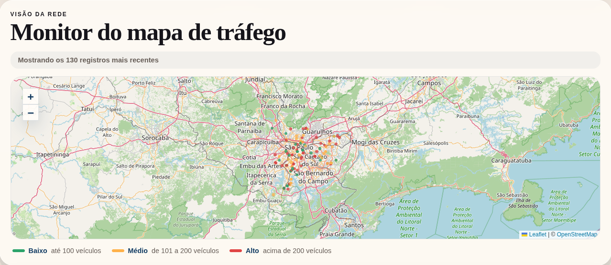
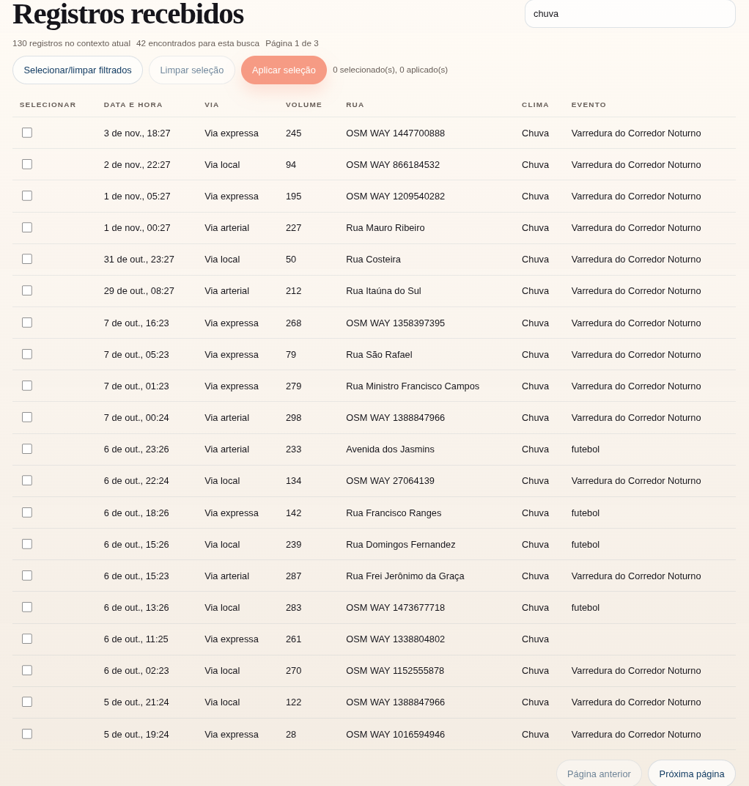

# SmartTrafficFlow

Este é um projeto de hackathon desenvolvido no contexto da comunidade **NoCountry**.  
O objetivo é centralizar análise de tráfego urbano com:

- coleta e cadastro de registros de tráfego,
- visualização de mapa e indicadores,
- geração de insights e exportações,
- simulação de cenários.

> **Sobre os dados:** os registros da demo não são reais. A maior parte foi gerada pela simulação da própria aplicação, sobre ruas reais de São Paulo importadas do OpenStreetMap. Os volumes, o clima e os horários são sorteados e não representam o trânsito de verdade.

## Demonstração e infraestrutura

A aplicação está publicada em uma instância **Oracle Cloud Infrastructure (OCI)**, na região São Paulo, com HTTPS:

- **Demo:** [https://smarttraffic.andreteixeira.dev.br](https://smarttraffic.andreteixeira.dev.br)

O endereço antigo por IP (`http://168.138.135.46:5174/`) redireciona para o domínio.

> A demo é mantida em ambiente de avaliação e pode ficar indisponível eventualmente.

### Telas

**Página de insights:** os indicadores do volume registrado.


**Gráficos:** o volume por hora, por dia da semana e por tipo de via, no horário de São Paulo.


**Mapa:** os registros mais recentes sobre as ruas, com a cor pelo volume de veículos.



**Registros:** a tabela com busca, que entende os termos em português (aqui, `chuva`).



### Serviços

O deploy é orquestrado via **Docker Compose**, com três serviços em containers e um opcional:

| Serviço | Descrição |
|---|---|
| `smarttraffic-db` | PostgreSQL + PostGIS (banco geoespacial) |
| `smarttraffic-backend` | API Spring Boot |
| `smarttraffic-web` | Servidor web (Caddy): frontend, proxy de `/api` e HTTPS automático |
| `pgadmin-ui` | Administração do banco (opcional, perfil `admin`; não roda na demo) |

## Autoria

- **[Tirso](https://github.com/HandlezGZ):** a aplicação original, desenvolvida no hackathon da NoCountry (março e abril de 2026): backend, frontend, banco com PostGIS, importação de ruas e simulação.
- **[André Teixeira](https://github.com/AndreTeixeir):** no hackathon, os testes do frontend e do backend e o Docker do backend; depois, o deploy na OCI e as rodadas de correção descritas abaixo.

## Depois do hackathon

O projeto passou por uma revisão de código e por rodadas de correção, feitas no fork [AndreTeixeir/S03-26-Equipe-27-Web-App-Development](https://github.com/AndreTeixeir/S03-26-Equipe-27-Web-App-Development) e trazidas para este repositório. Em resumo:

- **Testes e CI:** GitHub Actions para backend e frontend; testes de banco com Testcontainers; testes unitários (surefire) separados dos de integração (failsafe).
- **Segurança da API:** sem senhas padrão (a aplicação não sobe sem elas); CORS restrito a origens exatas; Swagger só no perfil de desenvolvimento; limite de escritas por IP; limites no tamanho da página e da simulação; erros do cliente respondem 400, 404, 405 ou 415, e não 500.
- **Deploy:** frontend e API servidos pelo Caddy com HTTPS automático e domínio próprio; backend e web sem privilégios de root; containers que esperam o banco e o backend ficarem saudáveis; o endereço antigo por IP redireciona para o domínio.
- **Dados:** importação das ruas numa transação única, descartando geometrias e nomes inválidos; estatísticas agregadas no banco, em ordem fixa (24 horas, 7 dias, tipos de via) e no fuso de São Paulo; insights em português.
- **Tela:** textos em português; exportação CSV e JSON que respeita a seleção (o CSV no padrão RFC 4180, com proteção contra fórmulas); mapa com os registros mais recentes e legenda das cores; busca que entende os termos em português do clima e do tipo de via.

## Arquitetura

- `backend/`: API Spring Boot (Java 21) com JPA, Flyway e PostgreSQL/PostGIS.
- `frontend/latest-app/`: aplicação React + Vite + TypeScript, com Leaflet no mapa e Recharts nos gráficos.
- `infra/`: `docker-compose.yml` para banco, backend, web (Caddy) e pgAdmin (perfil opcional).

## Como rodar localmente

### 1. Backend

O backend precisa de um PostgreSQL com PostGIS e **não tem senha padrão**: sem `SPRING_DATASOURCE_PASSWORD` a aplicação se recusa a subir, com uma mensagem apontando a variável que falta.

O Spring Boot **não lê o arquivo `.env` sozinho**. Copie o exemplo, preencha os valores e exporte as variáveis no terminal (ou cadastre-as na configuração de execução da IDE, por exemplo no IntelliJ):

```bash
cd backend
cp .env.example .env
# edite o .env: defina SPRING_DATASOURCE_PASSWORD e, fora do Docker,
# troque o host de SPRING_DATASOURCE_URL para localhost
set -a && source .env && set +a
./mvnw spring-boot:run -Dspring-boot.run.profiles=dev
```

> **Não rode `./mvnw test` nem `./mvnw verify` nesse mesmo terminal.** Com `SPRING_DATASOURCE_URL` exportada, os testes deixam de usar o banco descartável (Testcontainers) e passam a apagar dados do banco apontado por ela. Rode os testes em outro terminal, sem as variáveis.

A importação de ruas vem desligada no `.env.example` (`APP_STREETS_IMPORT_ENABLED=false`). Para ligá-la, aponte `APP_STREETS_IMPORT_GEOJSON_PATH` para um arquivo local.

### 2. Frontend

```bash
cd frontend/latest-app
npm install
npm run dev
```

### 3. Infra com Docker Compose (opcional)

Copie `infra/.env.example` para `infra/.env` e preencha as senhas (`SMARTTRAFFIC_DB_PASSWORD` e `SMARTTRAFFIC_PGADMIN_PASSWORD` são obrigatórias, sem valor padrão). Fora do servidor, aponte também `SMARTTRAFFIC_BACKEND_ENV_FILE` (por exemplo `../backend/.env`) e `SMARTTRAFFIC_DATA_DIR` (uma pasta local que exista) para caminhos locais; os valores do exemplo são os do servidor. Detalhes em `infra/README.md`.

```bash
cd infra
cp .env.example .env
docker compose --env-file .env up -d --build
```

Sem domínio configurado, o app abre em `https://localhost` com certificado local (o navegador avisa que não é confiável).

Para subir também o pgAdmin:

```bash
docker compose --env-file .env --profile admin up -d --build
```

## Variáveis de ambiente

- Backend: use `backend/.env.example` como base.
- Frontend: use `frontend/latest-app/.env.production.example` como base.
- Compose: use `infra/.env.example` como base.

## Fonte do arquivo `export.geojson`

O arquivo de ruas usado na importação do backend **não é versionado** no repositório (o arquivo completo pode ser grande, ex.: ~150 MB).

Ele pode ser gerado pelo Overpass Turbo:

- URL: `https://overpass-turbo.eu/`
- Passos:
1. Acesse a URL.
2. Cole a query abaixo.
3. Ajuste o mapa para a região desejada.
4. Execute (`Run`).
5. Exporte em `Export -> GeoJSON`.
6. Salve como `export.geojson`.

Query exemplo:

```overpass
[out:json][timeout:180];
  area["name"="São Paulo"]["admin_level"="8"]->.sp;
  (
    way["highway"](area.sp);
  );
  out ids tags geom;
```

## Testes

### Backend

```bash
cd backend
./mvnw verify   # unitários (surefire, *Tests) e de integração (failsafe, *IT; precisa de Docker)
```

### Frontend

```bash
cd frontend/latest-app
npm test
```
